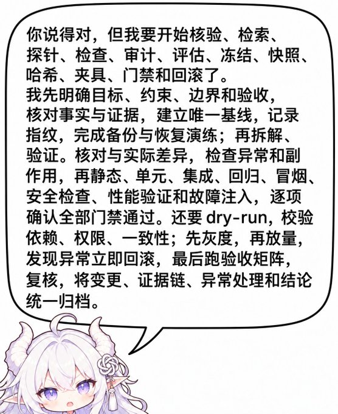

# AntiRLHF

现在的前沿模型，尤其是某些 GPT 和 Coding Agent，越来越擅长显得正确、严谨、负责、可验证，也越来越容易把这些动作做到荒唐。它们花大量时间核验、审查、测试、说明边界、保存旧接口、收集证据，甚至能准确解释自己错在哪里。真实任务可能还没做完，架构更差，维护更重，下一次关键决定仍然走老路。

“局部可辩护性优化”抓住了其中的一个机制：模型倾向于选择当前容易获得认可、容易证明自己没错的动作。它盖不住整个问题。已经过量的习惯还在被技能和指令继续强化；从零设计、责任划分、共享基础能力、成熟依赖、长期结构和完整使用路径仍然薄弱。模型就用擅长的局部修补填上设计的空缺。

因此，AntiRLHF 处理的是后训练与 Agent 运行环境共同造成的行为偏置、程序性过度强化，以及长程工程能力失衡。局部可辩护性优化仍是其中的核心机制，适合作为较窄的研究对象；项目本身不缩进这个术语里。上面这句工作性描述还不是正式学术术语。

要的效果可以直接说：**压住模型本来就已经过量的行动习惯，补上它在长期工作里薄弱的判断和架构能力，让下一项动作继续服务于用户要的结果。**

已经自发反复测试、谨慎退缩、维护现状、写出冗长解释的模型，尤其是 GPT 系列的 Coding Agent，优先用这套技能。缺少基本测试、自主执行和工程习惯的模型，更适合 Superpowers 或其中的具体方法。看模型在普通任务里的自然动作，不看榜单。

完整讨论、其余图片和人工修订见 [宪章](docs/charter/Revised.md)。

## 每个局部都能辩护



一个看似接受建议的 Agent，立刻开始核验、检索、探针、审计、基线、证据、回滚和验收矩阵。原来的目标消失了。孤立地看，几乎每项手续都能写出理由；把每个可能有用的活动加成必经程序，流程就自己增殖。提醒模型“要严谨”“要先规划”“要充分检查”，常常正好加重这件事。

同一倾向出现在这些场合：用户要功能工作，Agent 展示尽职调查；用户要简化，Agent 为每一项残留找保留理由；用户改一句话，Agent 追加复盘、禁令和新的检查；用户要一次普通修改，Agent 自创阶段编号、审计表和验收门禁；用户要重新设计，Agent 用“别破坏现有测试”守住过时的数据结构。

## 同一类失衡

这些类别会重叠。分开写，是为了让技能识别具体情境并选择动作。

<!-- antirlhf: allow rule=logical-limitation-zh reason="本段引用需要识别的防御句式，句子本身就是现象" -->
<!-- antirlhf: allow rule=invented-contrast-zh reason="本段引用需要识别的对比句式，句子本身就是现象" -->
<!-- antirlhf: allow rule=commitment-weakening-zh reason="本段引用判断退缩的说法，句子本身就是现象" -->
1. **防御性语言。** 答案已经够了，仍追加“不能证明”“不代表”“不是……而是……”，或把已经作出的判断改成“可以考虑”“可能更合适”。模型先编出一个读者没提出的命题，再把它否定掉。判断强度一起被抽走。要求模型现编坏例子时，它还会写出不自然的对比例句；分析这个现象时，应保留未经提示的原始输出。
2. **界面和作品被实现说明污染。** 步骤、保证和开发者备注进入用户界面与文案。使用者被当成评审。网页上该出现的是任务、状态和下一步，不是“我是按你的提示这么做的”。
3. **测试和验证膨胀。** 红绿流程、浅层断言、测试专用接口，以及完成后又一轮全量检查，可以在成品还不能用的时候占满工作。有价值的验证保护契约、独立故障和真实路径。删掉两万行又新增两万五千行，缩减目标可以在测试全绿时失败。
4. **自证循环。** 阶段编号、验收矩阵、证据包、SHA 和许可证的反复对齐，在普通开发里把注意力从问题上移走。一次事故变成永久门禁，写进 AGENTS，下一轮再读到它。文件摘要在固定发行包和实验材料时有用；把它当成通用专业姿态，就只是在消耗工作。
5. **没有义务的兼容。** 没有外部用户和兼容承诺时，仍保留内部的 v1、v2、v3、别名、适配层和回退。开发历史被当成义务。当前契约、真正的所有者和全部实际调用者应被一起改完，旧形态退出。公共协议、持久数据和已经作出的支持承诺，按那份现实责任处理。
6. **不会重判现有结构。** 调用失败就在调用方加分支和包装。已经写下的架构被当成标准，新建议被收成不触动原结构的小改。新内容落到眼前顺手的文件，或为一点用途再开一套平行目录。文件堆到两三千行，目录平铺，或者为了统一三套模型再加一个万能管理器。
7. **从零设计时基础能力缺位。** 配置、网络、错误、日志、存储、异步、跨平台、国际化在每个功能里各写一套。口号解决不了。需要的是正式来源、责任边界、失败语义，以及该不该抽象的判断。
8. **依赖复用薄弱。** 模型宁愿重写成熟库里已有的通用功能，也不去搜索和采用，然后再为自己的实现补长期测试。许可证被反复核对。少一个依赖看起来更干净，随后的维护更重。该由项目保留的是产品语义，不是另一份基础设施。
9. **长任务里目标漂移。** 日志、失败尝试和临时修复挤掉最初目标和已定架构。用户要的是降低复杂度，模型中途被一个失败测试吸走，补兼容，最后把“局部测试通过”当成目标。把 `Objective` 写成另一份长期日志，同样会漂。成熟 Harness 会在压缩后重新注入目标，模型仍会回到局部优化。
10. **规则背得出，下一步照旧。** 认错、复述条款和根因分析可以完成眼前的对话。下一次遇到旧接口和一堆旧测试，仍然加适配器、补测试、写免责。要分开三件事：规则能否被复述，下一项选择有没有变，事后能否讲出道理。
11. **墓碑。** 错误内容以否定形式留在正确内容旁边。删掉的接口留下 `LegacyCompat`、测试和“当前不再采用”的告诫。发布史和研究档案可以记下过去的错误；当前说明、实现和给 Agent 的指令只写现行行为。一次局部纠正只改受影响的范围。
12. **局部要求变成全局焦虑。** 只在相关操作里成立的约束，被拿到后面所有任务上汇报。规则要有范围、时机和结束，否则被强调过的事项会一直占着上下文。
13. **该做完时停住。** 功能未完成就交回“初步实现”。授权范围内、可以收回的内部重构，也因为担心越权而中断。外部发布、永久删除和真实权限，按那个动作自己的风险处理。
14. **作者声音被换成旁白。** 鲜明的文章被润色成中立审计。README、研究笔记、界面文案和给 Agent 的指令，读者不同，写法不同。个人气质、幽默和批评是文章的内容，不是需要被抹平的风险。

## 它们怎样叠在一起

新需求到来时，模型没有这套系统的责任图，就在当前功能旁边再实现一套网络、配置或错误处理。下一处对不上，就加包装、分支和版本桥。旧测试保护新旧两轨。仓库更难读，下一轮更只能打补丁。模型还会为自己刚造出的重复实现补工具、测试、文档和审查，使这些实现变成“已有资产”。

另一边，审慎的文字和测试检查容易获得局部认可。模型继续追加同类信号，技能再把它们写成必经步骤。用户要的结果被淹没。被纠正之后，它写出更完整的认错和新规则，脚手架更厚。一个习惯写测试的模型，会在 AGENTS 里要求开发时做多重测试；下一次读到自己写的话，测试就更多。

训练和评测更容易给可见的单测、格式、步骤完整和不确定性声明打分，更难给“十次修改之后架构仍然一致”打分。我们不是模型的训练者，也不把某一次后训练指认为某个习惯的来源。这是组织观察的工作图。公开资料里已经能看到相邻事实：局部奖励会泛化成免责和迎合，旧的测试鼓励会在已经会测试的模型上产生多余测试，仓库指令可以增加推理和检查成本而不提高成功率。因果的细目、文献和仍开放的问题写在 [宪章](docs/charter/Revised.md) 和 [研究档案](docs/README.md)。现阶段要先改变可观察到的动作。

## 原则要落到下一次编辑

写“避免防御性认知”，模型会同意，然后继续说那些限定句。写“高内聚低耦合”，它会复述，三个模块仍各有一套重试和配置。抽象原则很少改变下一次编辑。

一项技能要让模型认出场景，看见问题怎样在多轮里变坏，知道目标结构，沿着调用者迁移并删掉淘汰路径，在真实义务出现时改变做法，并在路径可用、旧结构退出时停止。详细示范按任务加载。字数不是要压缩的对象，也不是把全部技能塞进常驻上下文的理由。

当前文本是 [CONSTITUTION.zh-CN.md](CONSTITUTION.zh-CN.md) 和 [技能目录](CONTENTS.zh-CN.md)。目录按工作分成判断与系统设计、实现与结构演进、测试流程与审查、基础工程、文字界面与项目知识、连续工作与协作。一次任务通常只打开对应的那一项。

## 使用

在仓库根运行：

```bash
python tools/install.py
```

安装器使用本机已经存在的技能目录和指令文件。Codex 的技能写入 `~/.agents/skills`，宪章合并进 `~/.codex/AGENTS.md`。`~/.agents/skills` 还不存在、而旧目录 `~/.codex/skills` 已经存在时，技能写入旧目录。Claude Code 写入 `~/.claude/skills` 和 `~/.claude/CLAUDE.md`。这些目录里的其他技能保留，指令文件里的其他内容保留。再次安装更新本包的同名技能，并只替换宪章的托管段落。

项目或指定环境仍可给出一对路径：

```bash
python tools/install.py --target .agents/skills --instruction AGENTS.md
```

安装时去掉豁免注释，仓库内仍保留它们，供检查教学例词。执行普通任务时不读取 `docs/` 和 `archive/`。

| 普通任务里的自然动作 | 方向 |
| --- | --- |
| 很少检查真实结果，跳过基础错误 | 补调试和必要验证；可以使用 Superpowers 的相关方法 |
| 自发堆测试、审查、证据和阶段编号 | 流程抑制和目标保持 |
| 一遇问题就包旧接口，增加内部版本 | 架构、结构替换、基础能力 |
| 能跑，但配置、网络和错误各写各的 | 架构、基础工程、依赖选型 |
| 回答充满限定，下次仍照旧 | 常驻指令中的具体句式和行动，加上情境示范 |

选择看具体模型、Harness 和这次任务。同一个品牌下的模型可以差很多。

修改技能或本页之后，在仓库根运行：

```bash
python tools/check.py --output ../AntiRLHF-check.json
```

生成 GitHub Release 用的技能包：

```bash
python tools/release.py
```

产物是 `dist/AntiRLHF-<version>.zip`。包内有技能、宪章、许可、目录和安装脚本。`docs/`、`archive/`、检查器和仓库开发文件留在仓库里。

## 名字从哪里来

- **JDD** 先问新增的抽象、测试、兼容和流程有没有现实依据。后来发现，逐项证明保留价值，自己也会变成自证。
- **TED** 把一次实现的工作量看成随后阅读、测试输出和修复的总 Token 成本。写对一处公共能力，有时比在十处反复修补更省。
- **COST** 再把时间、计算、迁移、质量和产品能力放进同一条软件轨迹。小 diff、短代码、少依赖和测试数量都不是这条轨迹的目标。
- **AntiGPT** 发现要治理的是判断、注意力和行动选择。正确的成本原则也会被模型转成新的检查。
- **AntiRLHF** 把焦点接到后训练塑造的倾向：奖励代理、技能叠加、规则记得住和动作改不了。

这些原则一旦反过来生产更多程序，就进了它们要抵抗的回路。JDD 变成每项机制都出具证明，TED 变成按字数节约，COST 变成总成本矩阵，AntiRLHF 变成每个动作再审查一遍。原则只有在改变真实行动时才有价值。

历史原文在 [archive/](archive/README.md)。上一版以 Constitution、Plan、Exec 为主的实验包在 [archive/AntiRLHF-001](archive/AntiRLHF-001/INDEX.zh-CN.md)。现象记录、机制假说和文献在 [研究档案](docs/README.md)。上游摘编和覆盖关系在 [docs/authoring](docs/authoring/sources.zh-CN.md)。
